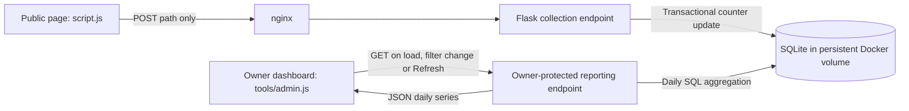

# Nexusflow analytics architecture

## Current behavior

Visitor and page-view data are stored in **SQLite**. Accepted page views update the database during the collection request; they are not queued for an hourly batch. Daily chart datasets are computed from the current stored counts when the admin requests them. **No cron job is required to compute analytics.**

The dashboard is a snapshot, not a live stream. It requests fresh data after sign-in or page reload, when a period/page filter changes, when the owner clicks Refresh, and after changing the saved top-page count. It does not currently poll, use WebSockets, or receive server-sent updates. Resizing a chart or switching tabs redraws the existing snapshot without fetching new data. CSV downloads also use that snapshot and include one column per displayed top page.

Thus, another visitor's accepted page view is available to the next analytics request as soon as its write commits, but an already-open chart stays unchanged until refreshed. The collection response is sent after the transaction completes. There is no intentional hourly delay.

## Components and request flow



| Component | Responsibility | Source |
| --- | --- | --- |
| Shared browser script | Send a page-load event when a supported public document first becomes visible | [script.js](script.js) |
| nginx | Serve static assets, proxy API requests, rate-limit collection | [nginx.conf](nginx.conf) |
| Flask/Gunicorn API | Verify access, accept events, update counters, query reports | [portal_api/analytics.py](portal_api/analytics.py), [portal_api/__init__.py](portal_api/__init__.py) |
| SQLite connection layer | Transactions, WAL mode, connection settings | [portal_api/db.py](portal_api/db.py) |
| Admin UI | Fetch reports, draw daily charts and export CSV | [tools/admin.js](tools/admin.js), [admin.html](admin.html) |

### Collection

1. A visitor opens a supported public page. The shared script sends one event per document load; if the page starts in a background tab, it waits until visible. Reloads count again. Returning to an already-counted tab does not itself generate another view.
2. The request posts JSON such as `{"path":"/about.html"}` to `/bms_integration_hub/api/analytics/collect`. `/index.html` is normalized to `/`. Query strings, form data, and uploaded file contents are not sent.
3. Admin and portal paths are excluded. The client respects Do Not Track and Global Privacy Control. The API also checks those request headers, excludes empty user agents and recognizable bots, and validates the path format. Path validation is a format check, not a lookup of existing files.
4. nginx limits collection to 2 requests/second per observed client IP, with a burst of 20, and a 1 KB request body limit. A rejected rate-limited request receives HTTP 429. This limit depends on the IP nginx observes behind the existing reverse proxy.
5. The API obtains or creates a random browser identifier in the first-party visitor cookie. It derives a daily visitor hash, then atomically inserts or increments the corresponding row in SQLite.
6. The transaction commits and the API returns HTTP 204. Excluded requests also return 204, without storing a view. The browser does not retry failed collection requests, so delivery is best effort.

The script tracks supported root public HTML pages and `/`. It does not track arbitrary nested application routes, time on page, clicks, or individual uploaded files.

## Storage and persistence

Production uses the same SQLite database as the customer portal:

- Database environment variable: `BMS_DATABASE_PATH`.
- Container path: `/data/bms_hub.sqlite3`.
- Persistent Docker volume: `nxflo-bms-data`, mounted at `/data`.
- API container: `nxflo-portal-api`; nginx is the externally exposed service.

Rebuilding images or replacing containers preserves the volume. Deleting the volume or losing the VM's storage loses the live database unless a backup is available. The database is not embedded in the static site, browser local storage, or Docker image.

SQLite uses WAL mode, a 5-second busy timeout, `synchronous=FULL`, and transactions beginning with `BEGIN IMMEDIATE` for writes. The counter increment is an SQL upsert, rather than an application read/modify/write sequence. Concurrent accepted events for the same key increment the same counter. SQLite still serializes writers; this is a single-VM design, not a distributed analytics warehouse.

### Tables

The analytics module creates these additive tables during API startup, if absent. It preserves the original collection start date across restarts. These tables currently sit alongside the portal's versioned migrations rather than having their own numbered migration.

```sql
CREATE TABLE analytics_meta (
    key TEXT PRIMARY KEY,
    value TEXT NOT NULL
);

CREATE TABLE analytics_daily (
    day TEXT NOT NULL,
    path TEXT NOT NULL,
    visitor TEXT NOT NULL,
    views INTEGER NOT NULL,
    PRIMARY KEY (day, path, visitor)
);
```

`analytics_meta` stores a `started` key containing the Vancouver calendar date when analytics was first initialized.

Each `analytics_daily` row represents **one browser on one page on one Vancouver calendar day**:

| Column | Meaning |
| --- | --- |
| `day` | Server-assigned `YYYY-MM-DD` date in `America/Vancouver` |
| `path` | Public page path, without query strings |
| `visitor` | Hexadecimal HMAC-SHA256 of the date and browser cookie identifier |
| `views` | Number of accepted views for that browser/page/day |

For each accepted page load:

```sql
INSERT INTO analytics_daily VALUES (?, ?, ?, 1)
ON CONFLICT(day, path, visitor)
DO UPDATE SET views = views + 1;
```

The database does **not** store one raw event row per page view. Repeated views increment a counter. There are no analytics event timestamps, session durations, hourly buckets, or stored hourly reports. Hourly analytics cannot be reconstructed later from these daily counters.

### Visitor identity and privacy

The production cookie is `__Secure-nxflo_visitor`. It contains a random identifier, expires 180 days after its latest accepted collection response, and is `Secure`, `HttpOnly`, and `SameSite=Lax`. Its path is restricted to the collection endpoint. Tests use a non-Secure cookie name.

The server stores only:

```text
HMAC-SHA256(persistent signing secret, YYYY-MM-DD + ":" + browser identifier)
```

The same browser has the same hash across pages on the same day, allowing daily deduplication. Its hash changes the next day. The signing secret persists in `/data/.auth-signing-key` and is also used by existing authentication code; it is not returned in analytics reports.

Analytics tables store no raw cookie identifiers, IP addresses, email addresses, user-agent strings, query strings, or referrers. Standard reverse-proxy and application access logs are separate systems and can contain request information.

A visitor means a browser estimate, not an identified person. Cookie clearing/blocking, multiple devices, first-visit cookie races across simultaneous tabs, and automated traffic can affect accuracy. Known-bot checks are heuristic. Owner visits to public pages are included, even while signed in. The admin page remains excluded. Reloading a public page increases page views; repeat visits by the same browser on the same day do not increase daily visitors. Views discarded by the earlier owner-exclusion rule cannot be recovered from these tables.

## Reporting and definitions

`GET /bms_integration_hub/api/admin/analytics?months=3&path=` requires an active, approved owner session. `months` accepts `3` or `6`; an empty `path` means all recorded pages. A selected path must exist in the recorded page list. Pages with no recorded views are not yet listed as filter options.

The reporting query runs on demand:

```sql
SELECT
    day,
    COUNT(DISTINCT visitor) AS visitors,
    SUM(views) AS page_views
FROM analytics_daily
WHERE day BETWEEN ? AND ?
  AND (? = '' OR path = ?)
GROUP BY day;
```

- **Daily visitors:** distinct daily browser hashes across the selected pages. A browser visiting Home and About on the same day counts once in the all-pages visitor total.
- **Daily page views:** sum of all accepted view counters in the selected scope. Reloads and repeat views count again.
- **Period page views:** sum of daily page views in the selected period.
- **Today's counts:** the last daily row in the returned series; today's values are partial.

Distinct visitors across multiple days cannot be computed from these changing daily hashes. Adding daily visitors gives visitor-days, not unique visitors for the entire period.

The API selects the last three or six calendar months through today, with inclusive date bounds. The effective start is the later of that rolling-window start and the persisted collection start date. It fills missing measured days with zero and omits dates before collection began from all chart series, tables, and exports. `start` is the effective first date; `requested_start` preserves the original rolling-window bound. That does not backfill historical traffic. There is no collection-uptime ledger: outages and blocked collection can also result in zero or incomplete counts after the start date.

All periods, day boundaries, and retention cutoffs use `America/Vancouver` on the server. No midnight job is needed: a request after midnight naturally uses the next date and a new daily hash. A tab left open across midnight does not generate a view merely because the date changed.

The response is JSON containing the daily series, available page paths, collection start date, date bounds, and timezone. The browser renders both daily charts and the detailed table from that response. API responses use `Cache-Control: no-store`; any staleness in an open dashboard comes from its retained snapshot, rather than an intentional report cache.

## Top-page comparison and saved preferences

The page-view chart draws a separate daily line for each of the top pages, ranked by total accepted page views over the selected three- or six-month interval. The default limit is eight. Ties use page path ascending for deterministic ranking. The legend shows the matching line color, page name, and period total; the daily table and CSV include exact per-page columns. Table column numbers match the numbered legend, keeping numeric columns compact; header tooltips and CSV headers preserve full page paths. Daily visitors and daily page views are displayed as two side-by-side charts, each with a date-labeled x-axis. The page-view chart retains its separate top-page series; the visitor chart shows daily distinct browsers.

The report response includes `top_pages_limit` and `top_pages`, an ordered array containing each page's `path`, `total_views`, and daily `{day, page_views}` series. All series share the report's date axis. Missing measured days become zero; dates before collection began are omitted. Only pages with recorded views in the selected interval are ranked. If fewer pages are available than the chosen limit, only those pages are shown. Today's page-view total in the chart header still covers all pages, including pages outside the top-page limit. Standalone numeric KPI cards are omitted.

Ranking is calculated on demand:

```sql
SELECT path, SUM(views) AS total_views
FROM analytics_daily
WHERE day BETWEEN ? AND ?
GROUP BY path
ORDER BY total_views DESC, path ASC
LIMIT ?;
```

The selected count is stored in `analytics_meta` under `top_pages_limit`, initialized to `8` without overwriting a saved value at startup. The admin control accepts 1–20 pages. `PUT /bms_integration_hub/api/admin/analytics/preferences` accepts `{"top_pages_limit": 8}` and requires the existing approved owner session, matching Origin, and CSRF token. The preference persists across browser reloads, browsers, and container restarts in the same persistent SQLite volume. No cron or extra dataset table is needed. Existing API path-filter support remains available, but the dashboard uses all-site comparisons rather than a single-page dropdown.

## Troubleshooting missing views

Under **Analytics → About these numbers → Check this browser**, the owner can diagnose the same browser/privacy mode used for browsing. The check first reads browser DNT/GPC settings. If permitted, it sends `POST /bms_integration_hub/api/analytics/collect` with `{"probe":true}`. The response reports `ready`, `privacy_opt_out`, or `bot_filtered`; it does not write counters, set a visitor cookie, or create a test page view. A failed or blocked request is reported separately from a privacy exclusion. A successful probe establishes connectivity and eligibility in that browser, not proof that every public-page request was delivered.

Normal collection responses include `X-Analytics-Status: counted`, `privacy_opt_out`, or `bot_filtered`. A bare HTTP 204 alone does not establish that an event was stored. Browser-side DNT/GPC exclusions and content blockers can prevent the request from being sent at all, in which case the API cannot record or explain that missing request. Private windows may have different protection settings. This system respects privacy choices and does not bypass content blockers.

A live verification navigated Home, About, Services, and Contact in a clean private Chromium context with a standard browser user agent: all four collection requests returned 204 and all four page counters were verified in SQLite. The verification used a dedicated random visitor cookie; only that test visitor's rows were then removed. No pre-existing visitor rows were modified. This verifies that the deployed collection path can work, not the settings in a particular user's browser.

## Scheduled jobs, retention, and backups

| Work | Current trigger | Cron required? |
| --- | --- | --- |
| Record a page view | Accepted collection request | No |
| Deduplicate daily visitors | Browser/day hash and reporting query | No |
| Compute daily chart dataset | Owner report request | No |
| Update an already-open dashboard | Reload, filter change, or Refresh button | No; automatic polling is not implemented |
| Initialize analytics tables and collection start | API startup | No |
| Remove old live analytics rows | Each accepted collection transaction | No |
| Create database backup | Deployment script, before replacing services | No for deployment backups; no scheduled backup job is defined here |

Retention currently deletes rows with a day **strictly earlier than today minus 400 days**. The boundary date remains, so there can be 401 calendar-date buckets including today. Cleanup runs on accepted collection requests; if there is no accepted traffic, old rows remain until the next accepted request. This is not a strict wall-clock deletion schedule. Deleting rows does not automatically shrink the SQLite database file, and it does not delete old backup files.

[2_deploy_docker.sh](2_deploy_docker.sh) creates a consistent pre-deployment database snapshot under `/data/backups/predeploy-<timestamp>.sqlite3`, using SQLite's backup API and an integrity check in [portal_api/backup.py](portal_api/backup.py). It includes analytics and portal tables. These copies live in the same Docker volume. They are not an offsite backup, and no automatic backup pruning is configured by these scripts. The database snapshot does not include the separate `.auth-signing-key` file; preserving the volume's secret matters for continuity of existing sessions and same-day visitor hashing.

A periodic job would be useful for scheduled/offsite backups, backup pruning, or time-driven retention regardless of traffic. Those are operational additions, not prerequisites for producing the current analytics dataset. If reporting traffic or stored data grows enough to make direct aggregation slow, measure the queries before adding summary tables or a separate database.

## Access protection

The static admin page contains the login/dashboard shell, not embedded analytics data. Google credentials are verified on the server. Reporting requires the existing HttpOnly session cookie and owner authorization on every request; knowing the API URL does not grant access. Non-owner and anonymous accounts cannot query the dataset. Mutation endpoints use the existing origin/CSRF protections; collection requires the configured origin.

Authentication implementation: [portal_api/__init__.py](portal_api/__init__.py). Analytics behavior and access tests: [tests/test_analytics.py](tests/test_analytics.py). Dashboard/browser checks: [tests/check_analytics.py](tests/check_analytics.py).
